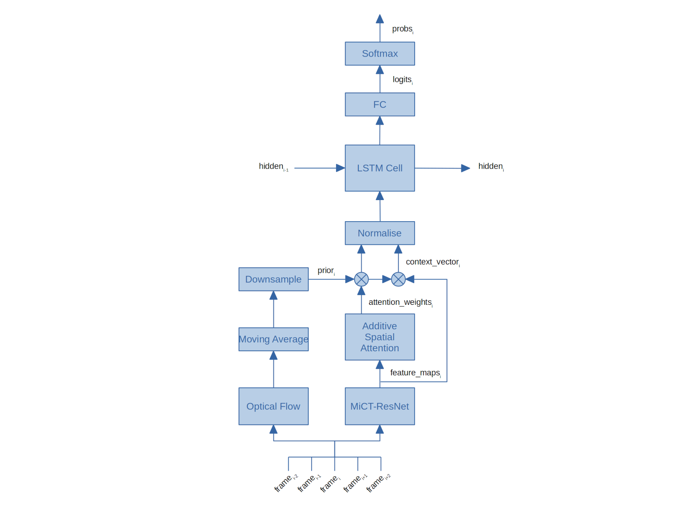

# MiCT-RANet for ASL Fingerspelling

This repository introduces MiCT-RANet, an efficient Deep Neural Network architecture for real-time recognition of ASL fingerspelled video sequences.
It achieves **77.2% letter accuracy** on the **ChicagoFSWild+** test set, and improves the original paper by a whopping 24%. 
Furthermore, after fine tuning this model on **FSBoard**, it achieves **92.7%** on the **FSBoard** test set (alpha subset). 
This is the raw model performance; a language model can be added on top to correct spelling errors.
A **fingerspelling practice application** using this model is also included in this repository. 
To our knowldege it is the first fully functional fingerspelling application based only on RGB frames.


MiCT-RANet mainly combines research from these papers and adds an improved training procedure:

* [Mixed 3D/2D Convolutional Tube (MiCT) for Human Action Recognition](https://www.microsoft.com/en-us/research/uploads/prod/2018/05/Zhou_MiCT_Mixed_3D2D_CVPR_2018_paper.pdf): this CVPR'18 paper proposes to augment a 2D ConvNet backbone with a small number of parallel 3D convolutions introduced at key locations. This architecture allows the 3D convolution branches to only learn residual temporal features, which are the motion of objects and persons in videos, to complement the spatial features learned by 2D convolutions. My implementation of MiCT uses a ResNet backbone and is described in detail in this [Medium story](https://towardsdatascience.com/mict-net-for-human-action-recognition-in-videos-3a18e4f97342).

* [Fingerspelling Recognition in the Wild with Iterative Visual Attention](https://arxiv.org/pdf/1908.10546.pdf): this ICCV'19 paper introduces the ChicagoFSWild+ dataset, the largest collection to date of ASL fingerspelling videos. The team at University of Chicago achieved 62.3% letter accuracy on this recognition task using recurrent visual attention applied to the features maps of an AlexNet backbone. They developed an iterative training approach which increasingly zooms on the signing hand, thereby eliminating the need for a hand detector.

* [FSboard: Over 3 million characters of ASL fingerspelling collected via smartphones](https://arxiv.org/abs/2407.15806): this CVPR'25 paper introduces FSBoard, an American Sign Language fingerspelling dataset situated in a mobile text entry use case. At >3 million characters in length and >250 hours in duration, FSboard is the largest fingerspelling recognition dataset to date by a factor of >10x.


### Repository Content

This repository includes:

* Source code of the Mixed 3D/2D Convolutional Tube (MiCT-Net) built on the ResNet backbone.

* Source code of the Recurrent Visual Attention Network.

* Evaluation code for ChicagoFSWild+ and FSBoard to reproduce the test accuracy.

* Pre-trained weights with ResNet18 and ResNet34 backbones.

* A Python application to practice your fingerspelling with a webcam.

If you use it in your projects, please consider citing this repository (bibtex below).


## MiCT-RANet Architecture Overview

As depicted below, the MiCT-RANet architecture combines a recurrent visual attention module with a MiCT-ResNet backbone.
This backbone is a pre-trained ResNet with additional 3D convolutions inserted using residual connections to form so-called Mixed 3D/2D Convolutional Tubes.

The recurrent visual attention network (RANet) uses additive attention (also called Bahdanau attention) in combination with an LSTM cell.
The LSTM cell's hidden state and the CNN feature maps are jointly used to yield an attention map. This attention map reflects the importance of features at each spatial location for the recognition of signing sequences.
The attention map is then weighted by the magnitude of the optical flow and re-normalized. The optical flow indicates the regions in motion within the image and provides a good attention prior for locating the signing hand.
Given the small size of the features maps, the optical flows can be computed in real-time on the CPU (using Farneback's algorithm) at low resolution without affecting accuracy.



The training procedure produces a model skilled for a large range of camera zoom with stable accuracy. The CTCLoss is used at train time while beam search with a beam size of 5 is used for decoding at test time. 


## ChicagoFSWild Dataset

The [ChicagoFSWild](https://ttic.uchicago.edu/~klivescu/ChicagoFSWild.htm) dataset is the first collection of American Sign Language fingerspelling data naturally occurring in online videos (ie. "in the wild"). The collection consists of two data set releases, ChicagoFSWild and ChicagoFSWild+.
Both contain short clips of fingerspelling sequences extracted from sign language videos crowd sourced from YouTube and Deaf social media.

The ChicagoFSWild dataset contains 7304 ASL fingerspelling sequences from 160 different signers, carefully annotated by students who have studied ASL. ChicagoFSWild+ contains 55,232 sequences signed by 260 different signers.
The train, dev, and test splits were designed to obtain signer-independent subsets. The merged dataset contains respectively 303, 59 and 58 unique signers for each split. This means that the accuracy of models trained with these 3 splits is reflective of their performance with unknown signers under various conditions (eg. indoor, outdoor, studio recording, etc...).


## FSBoard Dataset

The FSBoard dataset contains 151K video sequences collected from 147 paid and consenting Deaf signers using Pixel 4A selfie cameras in a variety of environments. 
Contrary to Chicago which was collected from social media, the signers were given phrases to record. These phrases are constructed with a variety of domains: MacKenzie phrases, URLs, addresses, phone numbers, and names. Therefore, sequences are not limited to characters from the alphabet, but also include numbers and special characters. The videos of this dataset have been made publicly available by Google and can be downloaded from [Kaggle](https://www.kaggle.com/datasets/googleai/fsboard). You will need 1.3TB of storage for the full dataset.


## Performance Analysis

This section reports test results on the test sets totalling 2583 samples for ChicagoFS+, and 2583 for FSBoard alpha subset.
The models' letter accuracy are measured with the Levenshtein distance. 
Note that ChicagoFS+ is a very challenging dataset: human performance is only 86.1% and inter-annotator agreement is about 94%. 
FSBoard, on the contrary, comes with 100% correct annotations due to its collection mechanism.


| Architecture                | Parameters  | Input size | 3D kernels size | Dataset    | Letter accuracy | Note               |
|-----------------------------|-------------|------------|-----------------|------------|-----------------|--------------------|
| Iterative-Visual-Attention  | xx.xM       | 192x192    | Not applicable  | ChicagoFS+ | 62.3            |                    |
| MiCT-RANet-34               | 32.2M       | 224x224    | 5x3x3           | ChicagoFS+ | 74.4            | V1 release in 2020 |
| MiCT-RANet-18               | 69.1M       | 224x224    | 5x3x3           | ChicagoFS+ | **77.2**        | V2 update in 2025  |
| MiCT-RANet-18               | 47.0M       | 224x224    | 3x3x3           | FSBoard    | 92.3            | Finetuning         |
| MiCT-RANet-18               | 47.0M       | 224x224    | 3x3x3           | FSBoard    | 91.7            | Without finetuning |
| MiCT-RANet-18               | 69.1M       | 224x224    | 5x3x3           | FSBoard    | 92.4            | Finetuning         |
| MiCT-RANet-18               | 69.1M       | 256x256    | 5x3x3           | FSBoard    | **92.7**        | Finetuning         |


Breakdown of errors for the best model evaluated on FSBoard test set (alpha subset): 

|                | Substitutions | Deletions | Insertions |
|----------------|---------------|-----------|------------|
| Error count    |           424 |       872 |       1256 |
| Error rate     |          1.2% |      2.4% |       3.5% |
| Error share    |         16.6% |     34.2% |      49.2% |

The test set has 36355 characters, and out of the 2552 errors, 637 are inserted spaces (25.0%) and 349 are deleted spaces (13.7%).


Top-10 of the mostly confused letter pairs:

|     | letter1 | letter2 | count |
|-----|---------|---------|-------|
|  1  |    i    |    y    |  63   |
|  2  |    e    |    o    |  27   |
|  3  |    r    |    u    |  26   |
|  4  |    a    |    s    |  22   |
|  5  |    a    |    o    |  15   |
|  6  |    n    |    t    |  12   |
|  7  |  space  |    l    |   9   |
|  8  |    a    |    y    |   9   |
|  9  |  space  |    p    |   7   |
| 10  |  space  |    n    |   7   |


The next table shows the accuracy as a function of the number of frames per signed letter for model **MiCT-RANet-34** trained only on ChicagoFS+. 
Performance increases monotonically with a plateau above 81% accuracy between 6 and 13 frames per letters.
This result is important for the calibration of the spelling application, to obtain optimal performance.


| Frames per letter | Mean acc. | Samples |
|-------------------|-----------|---------|
|                 1 |        22 |       6 |
|                 2 |        53 |     146 |
|                 3 |        66 |     289 |
|                 4 |        73 |     593 |
|                 5 |        77 |     392 |
|                 6 |        81 |     432 |
|                 7 |        82 |     205 |
|                 8 |        83 |     181 |
|                 9 |        81 |      88 |
|                10 |        81 |      95 |
|                11 |        82 |      43 |
|                12 |        86 |      27 |
|                13 |        84 |      21 |
|                14 |        76 |      23 |
|               15+ |        69 |      42 |


## Testing on Your Own
I'm providing below the link to the pre-trained weights to reproduce the above results and run the fingerspelling practice application included in this repository. Note that releasing the training code is out of the scope of this repository for the time being. A GPU with 16GB of RAM is needed to run these tests.


| Architecture                                                                                  | Parameters  | Letter accuracy |
|-----------------------------------------------------------------------------------------------|-------------|-----------------|
| [MiCT-RANet34](https://drive.proton.me/urls/3QC326KREG#owB6r4GkFdbN)                          | 32.2M       | 74.4            |
| [MiCT-RANet18-ChicagoFS_Large_69m_224p](https://drive.proton.me/urls/PG8100AET8#JPOcE7ySa8jg) | 69.0M       | 77.2            |
| [MiCT-RANet18-FSBoard_Medium_47m_224p](https://drive.proton.me/urls/S9GVDY2340#K4gfcHKRdQ2i)  | 47.0M       | 92.3            |
| [MiCT-RANet18-FSBoard_Large_69m_256p](https://drive.proton.me/urls/DD3WQPJGH8#wZAS2LZHAnvl)   | 69.0M       | **92.7**        |

You can test the model directly from the command line as shown below.

For the new model released in 2025 use one of these:

```
$ python test.py --conf conf_v2.ini --scale 2 --model_version=v2
[...]

$ python test.py --conf conf_fsboard_medium_224p.ini --model_version=v2
[...]

$ python test.py --conf conf_fsboard_large_256p.ini --model_version=v2
Compute device: cuda
2614 test samples
Loading weights from: data/MiCT-RANet18_FSBoard_large_256p.pth
Total number of encoder parameters: 69133744
Mean sample running time: 0.686 sec
239.6 FPS
Letter accuracy: 92.74% @ scale 2
```

For the older model released in 2020 use:
```
$ python test.py --conf conf_v1.ini --scale 2 --model_version=v1
Compute device: cuda
2583 test samples
Loading weights from: data/MiCT-RANet34.pth
Total number of encoder parameters: 32164128
Mean sample running time: 0.094 sec
298.1 FPS
Letter accuracy: 74.39% @ scale 2
```

Note that the `scale` parameter is irrelevant and ignored for FSBoard.

## Fingerspelling Practice App

A real-time fingerspelling interpreter is included in this repository. You can use it to practice your fingerspelling and evaluate MiCT-RANet's capabilities using a webcam or a smartphone connected to your computer. The quality of your experience will depend on your hardware performance, your ability to calibrate the application using the provided parameters, and your fingerspelling skills. 

**This application is provided as-is. It is not a product ! I will not provide support and may not respond to troubleshooting requests.**


I cannot advise what are the minimum hardware requirements. The model consumes only 2GB of RAM on GPU and runs smootly on a quad-core CPU.


### Usage and Calibration Tips
* **The application predicts the signed letter when you transition to the next one.** This means that it is useless to hold your hand and wait for the detection because nothing will happen until you start moving your fingers to sign the next letter.
* **It is desirable to sign fast because the model was trained with and for expert signers.** You can adjust the target FPS to your skill.
* **Be patient if you are learning fingerspelling** as the model was not made to be used by beginners. The application can still do okay if you sign slowly, but you will get more unexpected letter insertions.
* **Enable auto-focus and block exposure** and other automatic image adjustments as it may degrade performance by adding noise to the optical flow.
* **Position yourself at the right distance from the camera:** check the animations on this page for instructions and use your camera’s built-in zoom if needed.
* **Lightning must not be neglected:** your hand and face should not be casting shadows.


### Running the Application
To start the application with the default parameters simply run one of the following commands:

Use only the medium size model with the webcam application. Other models have 3D kernel sizes of 5x5x5, and are not suitable due to their too large receptive field.
```
$ python webcam.py --conf conf_fsboard_medium_224p.ini --frames_window=25 --min_gpu_buffered_frames=3 --target_fps=24 --model_version=v2
```

You can still run the old model with:
```
$ python webcam.py --conf conf_v1.ini --frames_window=17 --min_gpu_buffered_frames=1 --target_fps=12 --model_version=v1
```

**The main optional arguments are:**
* **frames_window:** the number of frames used to make each prediction. The receptive fields of model V1 and V2 are repectively 21 and 41 frames but a smaller window provides good results too. Higher values increase the lag.
* **flows_window:** the number of optical flows used to calculate an attention prior map. The default value is 5 and should not be changed.
* **min_gpu_buffered_frames:** the minimum number of frames needed in the buffer before running GPU inference. Higher values reduce GPU load but increase the lag.
* **target_fps:** the target FPS of the application. 
* **benchmark:** runs a 60 seconds application performance benchmark and prints the results.
* **compile:** compiling the model with torch significantly slows down the start of the application for a modest GPU speed improvement (~5%). Use only if the benchmark reveals that your GPU is the bottleneck.
* **model_version:** the version of the model, v1 for the former version or v2 for the newest.

**Commands**
* Press the `Delete` key to clear all letters.
* Press the `Enter` key to start a new line.
* Press the `Space` key to insert a space character. This is cheating but provided for convenience.
* Press the `Backspace` key to delete the last letter (this is also cheating !).
* Press the `r` key to start or stop recording. Each recording sequence will be saved in a new folder.
* Press the `Escape`, `q` or `x` key to exit the application.

## Requirements
CUDA 11.8, Python 3.10, PyTorch 2.2, and OpenCV 4.6.10

A webcam or smartphone. To use an Android phone as webcam you can use **DroidCamX Pro**. More information can be found by following this [link](http://www.dev47apps.com/).


## Citation
Use this bibtex to cite this repository:
```
@misc{fmahoudeau_mictranet_2025,
  title={MiCT-RANet for real-time ASL fingerspelling video recognition},
  author={Florent Mahoudeau},
  year={2025},
  publisher={GitHub},
  journal={GitHub repository},
  howpublished={\url{https://github.com/fmahoudeau/MiCT-RANet-ASL-FingerSpelling}},
}
